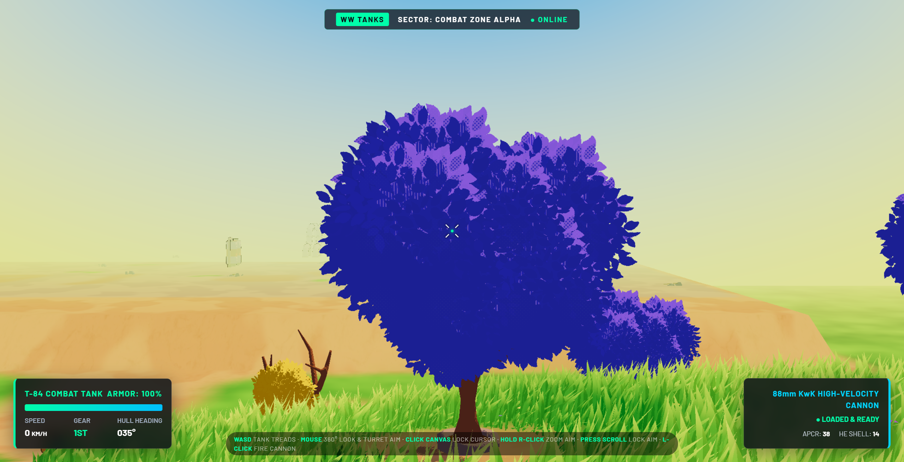
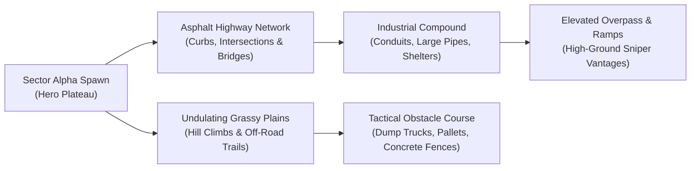
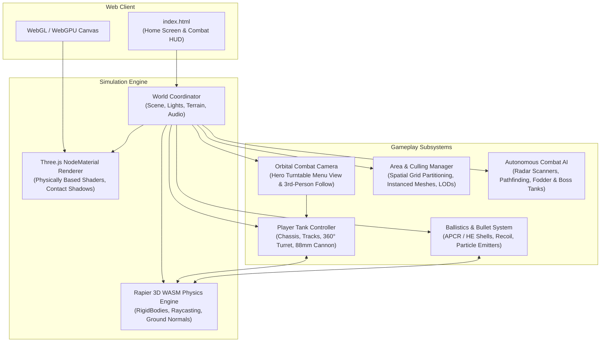

# World War Tanks: 3D Armored Warfare — Open World Combat Simulator



A high-fidelity, open-world 3D armored combat simulator built with **Three.js (NodeMaterial WebGPU/WebGL2)**, **Rapier 3D WASM Physics**, and an authentic direct-fire ballistics engine. Command a heavy combat tank across a vast multi-tiered sandbox battlefield featuring dynamic suspension, GTA-style track driving, independent 360° turret traverse, and precision sniper aim.

---

## 🎮 Playable Features & Gameplay

### 1. Authentic Armored Combat Vehicle
- **Heavy Tank Chassis**: Dynamic rigidbody physics with mass, inertia, friction, and multi-ray terrain surface normal conformance.
- **GTA-Style Driving**: Responsive forward drive (W), smooth proportional steering (A/D), and realistic reverse handling (S).
- **Turbo Boost (Shift)**: High-output powertrain acceleration for clearing obstacles and climbing steep terrain embankments.
- **Independent 360° Turret Traverse**: Turret rotates smoothly to track mouse aim with dedicated **Q / E swivel keys** for 360° defensive fire and reverse shooting on the run.

### 2. Direct-Fire Ballistics & Weaponry
- **88mm KwK L/71 High-Velocity Cannon**: Fires high-velocity Armor-Piercing Composite Rigid (APCR) and High-Explosive (HE) rounds.
- **Pinpoint Reticle Raycasting**: Shell trajectory aligns precisely with screen-center crosshair raycasting, guaranteeing 100% target accuracy with zero spread or misalignment.
- **Physical Recoil Simulation**: Synchronized cannon breech recoil, tank chassis rocking impulse, and volumetric particle muzzle flash and smoke puffs.
- **Breech Reload Cycle**: Real-time reload timer and munitions counter integrated directly with the cockpit HUD.

### 3. Precision Combat Aim System
- **Over-the-Turret Sniper Zoom (Hold Right-Click)**: Camera transitions smoothly into a tight over-the-turret sniper perspective (FOV drops from 36° to 25°), aligning crosshair focus for long-range targeting.
- **Combat Aim Lock (Press Scroll Wheel / Middle Click)**: Toggles locked Combat Aim mode on/off without needing to hold the right mouse button.
- **Smooth Orbit Zoom (Mouse Scroll)**: Dynamic orbital camera distance adjustment from 3.2m to 9.5m.

### 4. Interactive 3D Home Screen Menu
- **3D Hero Turntable Showcase**: When opening the game, the camera enters an automatic, slow 360° turntable orbit showcasing the 3D tank, its glowing headlights, and the open-world battlefield behind it.
- **Instant Deployment**: Clicking **"▶ DEPLOY TO BATTLEFIELD"** (or pressing `Enter`/`Space`) seamlessly swings the camera behind the tank into third-person driving view and activates the combat HUD.
- **Field Manual & Map Briefing Modals**: Built-in modal dialogs for controls manual, sector intel, audio toggle, and fullscreen mode.
- **In-Game Menu Access**: Pressing `ESC` or clicking the top-left `[⚙ MENU]` button returns to the home screen anytime.

---

## 🗺️ Sector Alpha: Open World Map



- **Topography**: 4 square kilometer continuous sandbox terrain with elevation shifts, grassy hills, dirt trails, and banked roads.
- **Road Infrastructure**: High-speed asphalt roadways equipped with concrete safety dividers, curbs, and elevated highway overpass ramps.
- **Industrial Sector**: Structural drainage conduits, industrial shelter hubs, utility poles, and transformer boxes.
- **Interactive Scenery Props**: Heavy dump trucks, stacked timber logs, concrete barrier fences, and hydrants.

---

## ⌨️ Controls & Keybinds

| Action | Input | Description |
| :--- | :--- | :--- |
| **Drive & Steer** | <kbd>W</kbd> <kbd>A</kbd> <kbd>S</kbd> <kbd>D</kbd> | GTA-style vehicle driving, proportional steering & reverse |
| **Look & Aim** | `Mouse Movement` | Situational 360° camera orbit & turret target tracking |
| **Precision Aim** | `Hold Right-Click` | Optical sniper zoom (FOV 25°) & locked crosshair alignment |
| **Toggle Aim Lock**| `Press Scroll Wheel` | Locks/unlocks Combat Aim mode (middle mouse click) |
| **Fire Cannon** | `Left-Click` / <kbd>Space</kbd> | Fire 88mm KwK High-Velocity Cannon at crosshair |
| **Turret Swivel** | <kbd>Q</kbd> / <kbd>E</kbd> | Independently rotate turret left/right (enables reverse shooting) |
| **Turbo Boost** | <kbd>Shift</kbd> | High-output powertrain acceleration across hills |
| **Camera Zoom** | `Mouse Scroll` | Dynamic orbital camera distance zoom (3.2m – 9.5m) |
| **Game Menu** | <kbd>ESC</kbd> / `[⚙ MENU]` | Return to 3D Home Screen Menu |

---

## 🛠️ Tech Stack & Architecture



- **Frontend & Rendering**: Three.js NodeMaterial (WebGPU/WebGL2), GSAP animation engine, CSS3 Glassmorphism.
- **Physics Simulation**: Rapier 3D WebAssembly (WASM) physics running 60fps real-time collision detection and ground normal alignment.
- **Asset Compression**: Google Draco 3D mesh decompression, Basis Universal (KTX2) GPU texture transcoding.
- **Audio Architecture**: Spatial 3D Web Audio with directional attenuation, engine loops, breech reloads, and ballistic explosions.

---

## 🚀 How to Run Locally

Clone the repository and serve using any local static HTTP server:

```bash
# Clone the repository
git clone https://github.com/Vrundpatel153/world-war-tanks-3d.git
cd world-war-tanks-3d

# Run using Python 3
python -m http.server 8080

# OR run using Node.js
npx serve .
```

Open your browser and navigate to:
**[http://localhost:8080/](http://localhost:8080/)**

---

## 📄 License
MIT License. Created by [Vrund Patel](https://github.com/Vrundpatel153).
